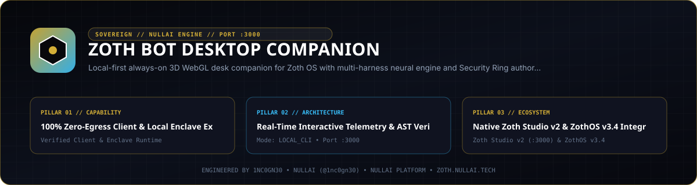

<div align="center">
  
</div>

<br />

<div align="center">
  <a href="https://zoth.nullai.tech/tools/zoth-bot"></a>
  <a href="http://127.0.0.1:8146"></a>
  <a href="https://buy.stripe.com/3cIfZg27PdKo2D64Ocfw40X"></a>
  <a href="LICENSE"></a>
</div>

# Zoth Bot Desktop Companion

Local-first 3D WebGL and multi-harness desktop agent companion for ZothOS v3.4.0 (`127.0.0.1:8146`). Combines an Electron + Three.js PBR companion stage, SQLite-backed conversation and audit persistence (`better-sqlite3`), OS keyring credential encryption (`safeStorage`), ZothOS Security Ring authority (`Rings 0–3`), an MCP server control hub, and an authenticated Tailscale mobile edge portal (`:9335`).

## Overview

| Property | Specification |
| :--- | :--- |
| **Tool ID** | `zoth-bot` |
| **Category** | `Swarm & Core` |
| **Loopback Workstation** | `http://127.0.0.1:8146` (`server.py`) |
| **Mobile Edge Portal** | `127.0.0.1:9335` or `<tailscale-ip>:9335` (`ZOTH_PORTAL_PORT`, `0600` token gated) |
| **Zoth Studio v2 Dossier** | [`https://zoth.nullai.tech/tools/zoth-bot`](https://zoth.nullai.tech/tools/zoth-bot) (`http://127.0.0.1:3000/tools/zoth-bot`) |
| **ZothOS v3.4.0 CLI** | `zoth-bot` (`bin/zoth-bot`) |
| **Summon Hotkeys** | `Ctrl+Shift+Space`, `Super+Shift+Z` |
| **License** | MIT — 100% Free & Open-Source |

## Architecture

1. **3D WebGL Companion & Dual-Mode Electron Window (`main.js`, `renderer/stage.js`)**
   - **Compact Orb (`220x220`)**: Frameless, draggable desktop orb with live status indicator.
   - **Expanded HUD (`432x760`)**: Interactive command panel rendering `zoth-guy.glb` and equippable `azoth-mask.glb` on a Three.js PBR stage with self-hosted `.woff2` typography (`Syne`, `Space Grotesk`, `JetBrains Mono`).
2. **Multi-Harness & Direct SDK Neural Router (`lib/agent.js`, `lib/providers.js`, `lib/sdkAgent.js`)**
   - **CLI Harnesses**: Nous Research Hermes Agent (`~/.local/bin/hermes --format stream-json --oneshot`), xAI Grok CLI (`--output-format streaming-json`), Hermes Copilot, and local Ollama (`127.0.0.1:11434`).
   - **Direct Vercel AI SDK Providers**: `xai`, `openai`, `anthropic`, `google`, and `ollama-sdk` with local tool definitions (`host_status`, `screenshot`, `clipboard_read`, `clipboard_write`, `run_command` with approval gate, `list_files`, `read_file`, `write_file`).
   - **Keyring Encryption & SQLite Store (`lib/keyStore.js`, `lib/db.js`)**: API keys are encrypted via Electron `safeStorage` (KWallet/libsecret) into `keys.enc.json` and never written in plaintext to `state.json`. Conversations, messages, scheduled jobs, and audit logs persist in `~/.config/zothos/zoth-bot/zoth-bot.db`.
3. **Security Rings & MCP Registry (`lib/tools.js`, `server.py`)**
   - Enforces ZothOS Security Rings: `Ring 0 (SOVEREIGN)`, `Ring 1 (SYSADMIN)`, `Ring 2 (TOOLMASTER)`, and `Ring 3 (SPECTRE)`.
   - Inspects `/etc/zothos/mcp-servers.json` and toggles registered MCP servers across host agent harnesses via `/usr/local/bin/zoth-mcp`.
4. **Authenticated Mobile Edge Portal (`lib/portal.js`, `lib/portalAuth.js`, `wear/`)**
   - Binds to the detected Tailscale interface or `127.0.0.1` (overridable via `ZOTH_PORTAL_HOST`, `ZOTH_PORTAL_PORT`, `ZOTH_PEER_IP`, `ZOTH_PEER_NAME`) and requires a `0600`-persisted token (`portal-token`) via query parameter, `x-zoth-token` header, or `HttpOnly` cookie. Includes an Android Wear OS companion module in `wear/`.

## Quickstart

```bash
git clone https://github.com/1nc0gn30/zoth-bot.git
cd zoth-bot
npm install

# Start the standalone loopback telemetry & workstation server on 127.0.0.1:8146
python3 server.py --host 127.0.0.1 --port 8146

# Launch the Electron 3D desktop companion
npm start
```

### Environment Variables

| Variable | Default | Purpose |
| :--- | :--- | :--- |
| `ZOTH_BOT_ROOT` | `~/.config/zothos/zoth-bot` | State, workspace, SQLite DB, and token directory |
| `ZOTH_PORTAL_HOST` | Detected `<tailscale-ip>` or `127.0.0.1` | Bind host for the `:9335` mobile portal |
| `ZOTH_PORTAL_PORT` | `9335` | TCP port for the mobile edge portal |
| `ZOTH_PEER_IP` | Dynamic `tailscale status --json` | Optional fallback peer IP for Taildrop handoff |
| `ZOTH_PEER_NAME` | `pixel-10-pro` | Optional fallback peer hostname for Taildrop |

## CLI & MCP Usage

### ZothOS v3.4.0 CLI (`bin/zoth-bot`)

```bash
./bin/zoth-bot --help
./bin/zoth-bot --status
./bin/zoth-bot --json
./bin/zoth-bot --rings --json
./bin/zoth-bot --mcp --json
./bin/zoth-bot --harnesses
./bin/zoth-bot --ui
./bin/zoth-bot --serve 8146
```

### Slash Commands (Desktop HUD)

| Command | Action |
| :--- | :--- |
| `/status` | Probe host daemon ports, active Security Ring, CPU load, and memory usage |
| `/provider [id] [model]` | List or switch direct SDK (`xai`, `openai`, `anthropic`, `google`, `ollama-sdk`) or CLI harnesses |
| `/key <id> <secret>` | Encrypt and store provider API key via OS keyring (`safeStorage`) |
| `/hermes [model]` | Switch active harness to Nous Research Hermes Agent |
| `/grok [model]` | Switch active harness to xAI Grok CLI |
| `/ollama [model]` | Switch active harness to local Ollama (`127.0.0.1:11434`) |
| `/ring <0-3>` | Switch ZothOS Security Ring (`0`=Sovereign, `1`=Sysadmin, `2`=Toolmaster, `3`=Spectre) |
| `/mcp` | Open the MCP Server Hub drawer |
| `/pocket` | Open the Pocket Workspace file explorer drawer |
| `/screen` | Capture desktop screenshot into Pocket Workspace |
| `/goal <text>` | Add a persistent goal for the active teammate |
| `/remember <fact>` | Append a durable memory entry to teammate `memory.md` |

### Loopback HTTP Endpoints (`127.0.0.1:8146`)

- `GET /health` and `GET /api/health` — Daemon health, version, loopback port, and open-access status.
- `GET /api/status` — Active Security Ring, summon hotkeys, and configured neural harnesses.
- `GET /api/rings` — Security Ring definitions (`Rings 0–3`) and active ring state.
- `GET /api/mcp` — Parsed MCP server registry from `/etc/zothos/mcp-servers.json` (with deterministic fallback).

## Testing & Verification

```bash
# Run Node/Electron ABI unit tests (SQLite DB, portal token auth, providers, SDK agent)
npm test

# Run Python HTTP & Security Ring endpoint tests
python3 -m pytest -q

# Verify CLI flags and JSON output
./bin/zoth-bot --help
./bin/zoth-bot --json
```

## Support

Zoth Bot is 100% free and open-source with zero paywalls or feature gates. Optional support: [Buy Us a Coffee via Stripe](https://buy.stripe.com/3cIfZg27PdKo2D64Ocfw40X).

## License

Released under the [MIT License](LICENSE). Engineered by [1nc0gn30](https://1nc0gn30.si) (`@1nc0gn30`) and [NullAI](https://nullai.tech).
